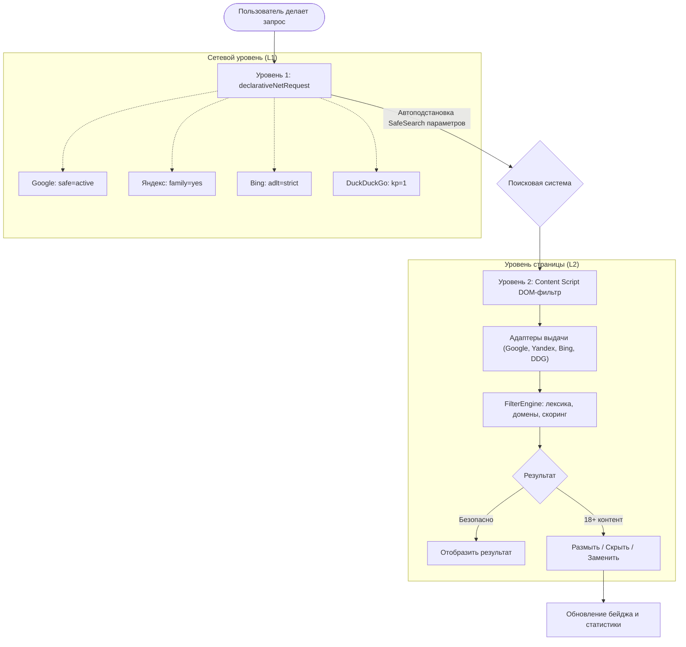

# SearchGuard 🛡️ — Защита поисковой выдачи

Архитектурный каркас браузерного расширения на базе **Manifest V3** (статус тестирования в браузерах см. в разделе «Совместимость с браузерами»).

Расширение создано для существенного снижения exposure (попадания на глаза) к порнографическому и взрослому (18+) контенту в поисковой выдаче за счёт принципа эшелонированной защиты (**Defense in Depth**).

---

## 🏗️ Архитектура: Два уровня защиты



### 1. Сетевой уровень (`declarativeNetRequest`)
- Перехват сетевых запросов ещё до отправки их на сервер без задержек в производительности.
- **Блокировка поисковых запросов 18+ (`rules/blocked_queries.json`)**:
  - Разделение на 4 компактных правила (501–504) для строгого соблюдения ограничения Chromium RE2 (лимит 2 КБ DFA памяти на регулярное выражение).
  - Мгновенный перехват и редирект на локальную страницу `blocked.html` для запросов на латинице и кириллице (`секс`, `порно`, `xxx`, `nsfw`, `nude`, `хентай`, `милф`, `анал`, `эрот`, `инцест` и др.).
- **Автоматическая модификация параметров поисковых запросов в строке URL (`rules/safesearch_rules.json`)**:
  - **Яндекс (`ya.ru`, `yandex.ru`, `yandex.com`)**: параметр `family=yes` (официальный документированный параметр режима «Семейный поиск» Яндекса, исключающий 18+ контент).
  - **Google (`google.com`, `google.ru` и др.)**: параметр `safe=active` (принудительный SafeSearch).
  - **Bing (`bing.com`)**: параметр `adlt=strict` (строгий фильтр взрослого контента).
  - **DuckDuckGo (`duckduckgo.com`)**: параметр `kp=1` (Strict SafeSearch).
- Опциональная блокировка прямых сетевых переходов на популярные домены 18+ (`rules/blocked_domains.json`).

### 2. Уровень страницы (`content script` DOM-фильтрация)
- Модульный **паттерн Адаптеров (`BaseEngineAdapter`)**:
  - `GoogleAdapter`: селекторы органической выдачи (`div[data-hveid]`, `div.wHYlTd.Ww4FFb.tF2Cxc.asEBEc.vt6azd[data-hveid]`, `.g`), блоков картинок и видео.
  - `YandexAdapter`: селекторы сниппетов Яндекса (`li.serp-item.serp-item__futuris-snippet.serp-item_card`, `li.serp-item.serp-item_card`) с дедупликацией вложенных элементов (`div.Organic` внутри `li.serp-item`).
  - `BingAdapter`: селекторы `li.b_algo`, `li.b_algo.b_vtl_deeplinks.qbrs`, картинок и видео.
  - `DuckDuckGoAdapter`: селекторы `article[data-testid="result"]`, `li[data-layout="organic"]`.
- **Интеллектуальный анализатор (`FilterEngine`)**:
  - Двуязычный словарь высокой и средней опасности (RU / EN).
  - Нормализатор текста и защита от обфускации (распознавание leetspeak: `p*rn`, `p0rn`, `s3x` и подмен букв).
  - Проверка доменов и доменных зон верхнего уровня (`.xxx`, `.adult`, `.porn`).
  - Система весового скоринга.
  - Поддержка белого списка поисковых доменов (`whitelistedDomains`): при добавлении поисковика в список content script корректно логирует `[SearchGuard Whitelist] Пропущено` и пропускает сканирование страницы.
- **Высокая производительность**:
  - `MutationObserver` для динамических результатов (бесконечный скролл, AJAX-подгрузка).
  - Кэширование проверенных узлов через `WeakMap` с сигнатурами текста (`data.rawText`), исключающее повторные сканирования и корректно обновляющееся при AJAX-мутациях.
  - Батчинг через `requestIdleCallback` / `requestAnimationFrame` (никаких фризов интерфейса).
- **Режимы сокрытия**:
  - `blur`: стильное размытие карточки с оверлеем и кнопкой «Показать» при необходимости.
  - `hide`: полное скрытие элемента из DOM (`display: none !important`).
  - `replace`: замена компактной информационной плашкой.

---

## 📁 Структура проекта

```
SearchGuard/
├── manifest.json                  # Манифест расширения Manifest V3
├── README.md                      # Документация проекта
│
├── rules/                         # Правила declarativeNetRequest
│   ├── safesearch_rules.json      # Сетевые правила SafeSearch для поисковиков
│   └── blocked_domains.json       # Блокировка прямых переходов на 18+ сайты
│
├── background/                    # Фоновый Service Worker
│   ├── service-worker.js          # Главный оркестратор жизненного цикла и сообщений
│   ├── dnr-manager.js             # Управление правилами declarativeNetRequest
│   └── badge-manager.js           # Управление счетчиком и бейджем на иконке
│
├── content/                       # Скрипты уровня веб-страницы (Content Scripts)
│   ├── content-script.js          # Контроллер страницы и MutationObserver
│   ├── content-style.css          # CSS-стили размытия, оверлеев и плейсхолдеров
│   ├── filter-engine.js           # Токенизация, деобфускация и алгоритм скоринга
│   └── adapters/                  # Адаптеры поисковых систем (Adapter Pattern)
│       ├── base-adapter.js        # Базовый абстрактный адаптер
│       ├── google-adapter.js      # Адаптер для Google Поиска
│       ├── yandex-adapter.js      # Адаптер для Яндекс Поиска (ya.ru, yandex.ru)
│       ├── bing-adapter.js        # Адаптер для Microsoft Bing
│       └── duckduckgo-adapter.js  # Адаптер для DuckDuckGo
│
├── popup/                         # Всплывающее окно быстрого управления (Popup UI)
│   ├── popup.html                 # Разметка всплывающего окна
│   ├── popup.css                  # Стили всплывающего окна (Glassmorphism)
│   └── popup.js                   # Логика быстрых переключателей и статистики
│
├── options/                       # Панель параметров и правил (Options Dashboard)
│   ├── options.html               # Полноэкранная панель управления
│   ├── options.css                # Тёмная современная тема панели настроек
│   └── options.js                 # Управление списками слов, доменов и бэкапами
│
├── shared/                        # Общие модули (SW, Content Scripts, UI)
│   ├── constants.js               # Константы, типы сообщений, селекторы
│   ├── default-rules.js           # Базовые словари ключевых слов и доменов
│   └── storage-helper.js          # Асинхронная обёртка вокруг chrome.storage.local
│
└── icons/                         # Набор иконок расширения
    ├── icon.svg                   # Векторный исходник иконки
    ├── icon16.png                 # Иконка 16x16
    ├── icon32.png                 # Иконка 32x32
    ├── icon48.png                 # Иконка 48x48
    └── icon128.png                # Иконка 128x128
```

---

## 🚀 Установка и запуск в браузере

Проект не требует компиляции или сборщиков (Webpack/Vite) — он написан на чистом нативном JavaScript стандарта ES2022+ и готов к загрузке «из коробки».

### 1. Google Chrome / Microsoft Edge
1. Откройте страницу управления расширениями:
   - В Chrome: `chrome://extensions/`
   - В Edge: `edge://extensions/`
2. Включите тумблер **«Режим разработчика»** (Developer mode) в правом верхнем углу.
3. Нажмите кнопку **«Загрузить распакованное расширение»** (Load unpacked).
4. Выберите папку проекта `SearchGuard`.

### 2. Яндекс.Браузер
1. Перейдите по адресу: `browser://tune` или `browser://extensions`.
2. Включите **«Режим разработчика»**.
3. Нажмите **«Загрузить распакованное расширение»** и укажите папку `SearchGuard`.

---

## 🧪 Проверка работы

1. **Проверка Уровня 1 (Сетевой SafeSearch)**:
   - Введите любой запрос в адресной строке в Яндекс (`ya.ru`) или Google (`google.com`).
   - Обратите внимание на итоговый URL в адресной строке:
     - В Яндексе автоматически добавится параметр `&family=1`.
     - В Google автоматически добавится параметр `&safe=active`.
2. **Проверка Уровня 2 (DOM-фильтрация)**:
   - Откройте страницу поисковой выдачи.
   - Элементы, содержащие ключевые слова или ссылки на запрещённые домены, автоматически получают размытие (`blur`) с фирменной плашкой `SearchGuard: Контент 18+ скрыт`.
   - На иконке расширения в панели браузера появится красный бейдж с числом заблокированных элементов.
3. **Панель настроек**:
   - Нажмите на иконку расширения и выберите **«⚙️ Настройки»**.
   - Добавьте свои ключевые слова или домены в реальном времени — они применяются мгновенно без перезагрузки браузера.

---

## 🔧 Добавление нового поисковика и архитектура модулей

### Архитектура скриптов: IIFE, глобальный namespace и порядок загрузки в Manifest V3

В **Manifest V3** контекст `content_scripts` не поддерживает нативные ES-модули (`import` / `export`) без предварительной компиляции бандлерами. Попытка использовать `export default` или `import` внутри Content Script приводит к фатальной ошибке браузера:  
`SyntaxError: Cannot use import statement outside a module`.

Чтобы обеспечить **zero-build** (работу без Webpack/Vite прямо из исходников) и модульность:
1. Все модули обёрнуты в **IIFE** (Immediately Invoked Function Expression) с регистрацией в общем пространстве имён `globalThis.SearchGuard` (в окне страницы это `window.SearchGuard`).
2. Адаптеры регистрируются в реестре: `window.SearchGuard.adapters.<name>`.
3. В `manifest.json` соблюдён строгий детерминированный порядок загрузки зависимостей:
   - Слой констант и хранилища (`shared/constants.js`, `shared/default-rules.js`, `shared/storage-helper.js`)
   - Базовый абстрактный класс (`content/adapters/base-adapter.js`)
   - Конкретные адаптеры (`content/adapters/*.js`)
   - Алгоритм фильтрации и скоринга (`content/filter-engine.js`)
   - Точка входа оркестратора (`content/content-script.js`)

Для добавления нового поискового сервиса (например, Yahoo, Ecosia):
1. Создайте класс-наследник в папке `content/adapters/yahoo-adapter.js`, расширив `BaseEngineAdapter`:
   ```javascript
   (function (root) {
     'use strict';
     root.SearchGuard = root.SearchGuard || {};
     root.SearchGuard.adapters = root.SearchGuard.adapters || {};

     class YahooAdapter extends root.SearchGuard.adapters.BaseEngineAdapter {
       constructor() { super('yahoo', 'Yahoo'); }
       matches(location) { return /(^|\.)yahoo\.com$/i.test(location.hostname); }
       getResultElements(root = document) { return root.querySelectorAll('.algo'); }
       extractData(el) { ... }
     }

     root.SearchGuard.adapters.yahoo = YahooAdapter;
   })(typeof globalThis !== 'undefined' ? globalThis : this);
   ```
2. Добавьте файл `"content/adapters/yahoo-adapter.js"` в список `"content_scripts"[0]."js"` в `manifest.json` (перед `filter-engine.js`).
3. Добавьте сетевое правило форсирования SafeSearch в `rules/safesearch_rules.json`.

---

## 🌐 Совместимость с браузерами

- **Microsoft Edge [156.0.4314.58]** — **PASS**, протестировано через CDP (05.11.2026)
- **Google Chrome [157.0.8103.38]** — **НЕ ТЕСТИРОВАЛОСЬ**, причина: запуск распакованного расширения через CLI `--load-extension` блокируется корпоративной политикой рабочей станции (наличие неотключаемых профильных расширений).
- **Яндекс.Браузер** — **НЕ ТЕСТИРОВАЛОСЬ**, причина: браузер не установлен в окружении тестирования.

> **Примечание по доменам**: E2E-тестирование в реальном браузере подтверждено как для международных зон (`yandex.com`, `google.com`), так и для национальных доменов Рунета (`yandex.ru`, `ya.ru`, `google.ru`). Селекторы адаптеров и сетевые правила DNR полностью идентично и стабильно работают во всех указанных зонах.

---

## 🛡️ Как работает Whitelist (Белый список)

В SearchGuard реализовано строгое разграничение двух механизмов белого списка:

1. **Домен в белом списке (`whitelistedDomains`)**:
   - При добавлении домена поисковой системы (например, `yandex.ru`, `yandex.com`) или сайта в `whitelistedDomains` Content Script расширения **полностью прекращает выполнение на этом домене**: `MutationObserver` не подключается, сканирование выдачи не производится, весь фильтр на странице выключен (`processedCount === 0`, `blurredCount === 0`). В консоль браузера выводится: `[SearchGuard Whitelist] Пропущено: домен <host> в белом списке`.
2. **Фраза в белом списке (`whitelistedPhrases`)**:
   - При добавлении контекстной фразы (например, `beethoven sextet`, `половое воспитание`, `математический анализ`) Content Script **продолжает штатно сканировать выдачу**, но конкретные результаты, содержащие разрешённую фразу, освобождаются от фильтрации (`shouldFilter: false, reason: "Фраза в белом списке исключений"`). Все остальные карточки выдачи продолжают проверяться и при необходимости скрываться.

---

## ⚠️ Известные ограничения (Known Limitations)

1. **Whitelist-фразы работают только на уровне Content Script (L2), а не DNR (L1)**:
   - Сетевой уровень `declarativeNetRequest` работает автономно в сетевом стеке Chromium и не имеет доступа к асинхронному хранилищу JavaScript `chrome.storage.local`.
   - Если запрос перехватывается статическим сетевым правилом блокировки (например, содержит изолированное слово `sex`), браузер немедленно выполнит редирект на `blocked.html` до того, как страница загрузится и Content Script сможет проверить `whitelistedPhrases`. Исключения по фразам предназначены для защиты безопасных сниппетов на этапе анализа DOM.

2. **Параметр `family=yes` в Яндексе — это умеренный (семейный), а не строгий SafeSearch**:
   - Параметр `family=yes` включает официальный семейный поиск Яндекса (исключающий страницы и сниппеты с явным 18+ контентом). Однако у Яндекса нет отдельного публичного URL-параметра для «абсолютно строгого» поиска без авторизации в Яндекс ID. Вторую линию защиты берёт на себя DOM-фильтр SearchGuard (`FilterEngine`), дофильтровывая сомнительные сниппеты прямо на странице.

3. **Настройка порога фильтрации (`threshold`) и False Positives**:
   - В панели настроек (Вкладка «Основные») доступно изменение порога чувствительности `threshold` (диапазон от 1 до 100, шаг 1, значение по умолчанию: **6**).
   - При занижении порога (`threshold < 4`) возрастает вероятность ложных срабатываний (False Positives) на безобидных страницах с медицинской или анатомической терминологией. При установке слишком высокого порога (`threshold > 30`) сниппеты с одиночными маркерами средней тяжести могут оставаться видимыми.

4. **Точное сопоставление границ слов в DNR для `sex` и формы слова**:
   - В правиле 505 (`rules/blocked_queries.json`) для термина `sex` реализовано регулярное выражение с обязательными разделителями слов в URL (`[?&](q|text)=(.*([+&]|%20))?sex([+&]|%20|$)`). Запросы `sex`, `sex video`, `video sex`, `sex%20video` надёжно блокируются. Слова, содержащие `sex` как подстроку (например, `sextet`, `sextet beethoven`, `секстет`), **не блокируются** сетевым экраном.
   - Правило 505 блокирует изолированный токен `sex` и его сочетания через `+` / `%20`, но пропускает формы `sexy`, `sexual`, `sexism`, `sexology`, `unisex`. Если нужна более агрессивная блокировка — добавьте эти формы в `customBlockedQueries` через options.

5. **Квоты и лимиты `chrome.storage.sync`**:
   - `chrome.storage.sync` имеет жёсткие ограничения Chromium: максимум **8,192 байт (8 КБ)** на отдельный ключ и **102,400 байт (100 КБ)** суммарно, а также лимит в **120 операций записи в минуту**.
   - Архитектурное решение в SearchGuard: базовые настройки интерфейса, флаги и числовой `threshold` синхронизируются через `sync`, а объёмные списки пользовательских слов (`customKeywords`), блокируемых сайтов (`customBlockedDomains`), исключений (`whitelistedDomains`, `whitelistedPhrases`) и счётчики статистики хранятся исключительно в `chrome.storage.local`.

6. **Зависимость DOM-селекторов от вёрстки поисковых систем**:
   - Поисковые гиганты (Google, Яндекс, Bing, DuckDuckGo) периодически проводят A/B-тестирование и меняют имена CSS-классов карточек выдачи (например, Google периодически меняет обёртки `.g`, `.MjjYud`, `[data-hveid]`).
   - Паттерн адаптеров `BaseEngineAdapter` изолирует эти селекторы: при изменении разметки поисковика правка вносится точечно в файл конкретного адаптера без риска сломать общую логику фильтрации.

7. **Троттлинг обновлений и кэширование узлов**:
   - Частые вызовы `chrome.action.setBadgeText` при быстром скролле динамической выдачи могут вызывать накладные расходы. В `content-script.js` применён батчинг через `requestIdleCallback` (с таймаутом 350 мс) и кэширование текстовых сигнатур узлов в `WeakMap`, что предотвращает повторное сканирование одних и тех же узлов, сохраняя реактивность при обновлении сниппетов.

8. **Поведение при `run_at: "document_start"`**:
   - На этапе `document_start` тег `document.body` ещё не создан парсером браузера (`null`). `MutationObserver` инициализируется на корневом узле `document.documentElement` (`<html>`), перехватывая узлы в потоке парсинга до их фактической отрисовки на экране, что предотвращает мелькание (FOUC) нежелательного контента.

9. **Ограничение RE2 2KB DFA Memory Limit в `declarativeNetRequest`**:
   - Движок сетевых правил Chromium компилирует регулярные выражения `regexFilter` с помощью библиотеки Google RE2. Для предотвращения DoS-атак на сетевой стек браузера установлен жёсткий лимит размера детерминированного конечного автомата (DFA) — не более 2048 байт.
   - Монолитные регулярные выражения с длинными списками ключевых слов и вариациями регистра превышают этот лимит и тихо отбрасываются браузером (`Rule was skipped as the "regexFilter" value exceeded the 2KB memory limit when compiled`).
   - Решение в SearchGuard: разделение блокируемых запросов на компактные правила (латиница и кириллические группы 501–505) с параметром `"isUrlFilterCaseSensitive": false`, что полностью исключает превышение лимита памяти.

10. **Поведение белого списка доменов (Полное отключение)**:
    - Внесение домена поисковика (например, `yandex.ru`, `yandex.com`) в `whitelistedDomains` полностью отключает Content Script на всем домене (см. раздел "Как работает Whitelist"). Для выборочного пропуска отдельных запросов следует использовать белый список фраз.
